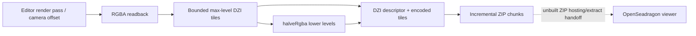

# Gigapixel / DeepZoom

*Fork-only pipeline inventory: open Draft PRs, not an integrated capability on main.*

Applies to: viewer capture/math, editor snapshot/export and OpenSeadragon presentation, core agent planning, MCP adaptation and standalone performance tooling.

## Boundary and delivery state

At [main 9449f7c](https://github.com/kvnloo/editor/commit/9449f7c5d0bf83b1a740687ab4f7d4cc94bacb9f), the existing posed capture is bounded to 8,192 px long edge / 24 MP (16 MP software), with 4,096 px render passes and 96 px seam overlap: [packages/editor/src/components/editor/thumbnail-generator.tsx:74-82](https://github.com/kvnloo/editor/blob/9449f7c5d0bf83b1a740687ab4f7d4cc94bacb9f/packages/editor/src/components/editor/thumbnail-generator.tsx#L74-L82). Existing tiled renders still compose one OffscreenCanvas: [packages/editor/src/components/editor/thumbnail-generator.tsx:1014-1020](https://github.com/kvnloo/editor/blob/9449f7c5d0bf83b1a740687ab4f7d4cc94bacb9f/packages/editor/src/components/editor/thumbnail-generator.tsx#L1014-L1020).

Ownership follows [E-001](https://github.com/kvnloo/editor/blob/9449f7c5d0bf83b1a740687ab4f7d4cc94bacb9f/DECISIONS.md#L38) and [viewer isolation](https://github.com/kvnloo/editor/blob/9449f7c5d0bf83b1a740687ab4f7d4cc94bacb9f/wiki/architecture/viewer-isolation.md#L1-L14): headless core, reusable viewer primitives, editor-owned camera/UI/encoding; MCP adapts the shared agent operation. Do not bypass [E-002 registry](https://github.com/kvnloo/editor/blob/9449f7c5d0bf83b1a740687ab4f7d4cc94bacb9f/DECISIONS.md#L40), [E-003 old scenes](https://github.com/kvnloo/editor/blob/9449f7c5d0bf83b1a740687ab4f7d4cc94bacb9f/DECISIONS.md#L42), or [E-010 agent parity](https://github.com/kvnloo/editor/blob/9449f7c5d0bf83b1a740687ab4f7d4cc94bacb9f/DECISIONS.md#L56). These leaves do not add a new scene kind.

Each source/test citation below is pinned to its PR's actual head SHA. All eleven PRs were **open Drafts** on 2026-11-04 (US Central). None is on main; no corresponding fork Actions run was found for these heads. All Bun tests, Biome, typechecks, device/browser tests remain **UNRUN** pending linked evidence.

## Data flow

Render-to-ZIP path: [packages/editor/src/components/editor/thumbnail-generator.tsx:1003-1066](https://github.com/kvnloo/editor/blob/c1cc693e2d885ab74065cb7d262630d080401bf7/packages/editor/src/components/editor/thumbnail-generator.tsx#L1003-L1066); [packages/editor/src/lib/gigapixel-capture.ts:212-306](https://github.com/kvnloo/editor/blob/c1cc693e2d885ab74065cb7d262630d080401bf7/packages/editor/src/lib/gigapixel-capture.ts#L212-L306). The read-only viewer instead consumes a served DZI and tile URLs, not the ZIP Blob: [packages/editor/src/components/deep-zoom-viewer.tsx:7-36](https://github.com/kvnloo/editor/blob/6c00daafa572af6ec39a905c283997232727f7a2/packages/editor/src/components/deep-zoom-viewer.tsx#L7-L36).

## Draft inventory

### [Draft #2](https://github.com/kvnloo/editor/pull/2) — viewer (editor caller)

**Export:** tileGrid(width, height, passEdge, overlap). **Guarantee:** Clipped GPU pass rectangles, disjoint authoritative interiors, configurable edge overlap and zero-based row/column; editor consumes the viewer export. Sources: [packages/viewer/src/lib/tile-plan.ts:20-39](https://github.com/kvnloo/editor/blob/fc09d7fb282633239a518fc80ffcc5232ec715c2/packages/viewer/src/lib/tile-plan.ts#L20-L39); [packages/viewer/src/index.ts:278-278](https://github.com/kvnloo/editor/blob/fc09d7fb282633239a518fc80ffcc5232ec715c2/packages/viewer/src/index.ts#L278-L278); [packages/editor/src/components/editor/thumbnail-generator.tsx:972-979](https://github.com/kvnloo/editor/blob/fc09d7fb282633239a518fc80ffcc5232ec715c2/packages/editor/src/components/editor/thumbnail-generator.tsx#L972-L979).

**Test:** [packages/viewer/src/lib/tile-plan.test.ts:14-89](https://github.com/kvnloo/editor/blob/fc09d7fb282633239a518fc80ffcc5232ec715c2/packages/viewer/src/lib/tile-plan.test.ts#L14-L89) (coverage, seams, pass bounds and single-pass). **Status:** Draft, tests UNRUN, CI not run. Head: [fc09d7fb2826](https://github.com/kvnloo/editor/commit/fc09d7fb282633239a518fc80ffcc5232ec715c2).

### [Draft #1](https://github.com/kvnloo/editor/pull/1) — viewer

**Export:** halveRgba(src, w, h). **Guarantee:** 2x2 alpha-weighted RGBA downsampling with ceil-half odd edges, zero-alpha handling and rounded alpha. Sources: [packages/viewer/src/capture/halve-rgba.ts:1-44](https://github.com/kvnloo/editor/blob/d0cbdff21df696a7aff8ae69dce3e3be3f725ebd/packages/viewer/src/capture/halve-rgba.ts#L1-L44); [packages/viewer/src/capture/index.ts:12-12](https://github.com/kvnloo/editor/blob/d0cbdff21df696a7aff8ae69dce3e3be3f725ebd/packages/viewer/src/capture/index.ts#L12-L12).

**Test:** [packages/viewer/src/capture/halve-rgba.test.ts:4-85](https://github.com/kvnloo/editor/blob/d0cbdff21df696a7aff8ae69dce3e3be3f725ebd/packages/viewer/src/capture/halve-rgba.test.ts#L4-L85) (six opaque/odd/alpha/single-pixel cases). **Status:** Draft, tests UNRUN, CI not run. Head: [d0cbdff21df6](https://github.com/kvnloo/editor/commit/d0cbdff21df696a7aff8ae69dce3e3be3f725ebd).

### [Draft #3](https://github.com/kvnloo/editor/pull/3) — viewer

**Export:** deepZoomMaxLevel, deepZoomLevelSize, deepZoomTiles, deepZoomDescriptor. **Guarantee:** Onepixel-depth pyramid size and tile geometry, clipped tile overlap, and DZI XML; no pixel encoder. Sources: [packages/viewer/src/capture/deep-zoom.ts:31-102](https://github.com/kvnloo/editor/blob/75a177911e95f558a930c285b86b68ed6367d3f7/packages/viewer/src/capture/deep-zoom.ts#L31-L102); [packages/viewer/src/capture/index.ts:11-18](https://github.com/kvnloo/editor/blob/75a177911e95f558a930c285b86b68ed6367d3f7/packages/viewer/src/capture/index.ts#L11-L18).

**Test:** [packages/viewer/src/capture/deep-zoom.test.ts:23-95](https://github.com/kvnloo/editor/blob/75a177911e95f558a930c285b86b68ed6367d3f7/packages/viewer/src/capture/deep-zoom.test.ts#L23-L95) (five level/tile/XML/input cases). **Status:** Draft, tests UNRUN, CI not run. Head: [75a177911e95](https://github.com/kvnloo/editor/commit/75a177911e95f558a930c285b86b68ed6367d3f7).

### [Draft #8](https://github.com/kvnloo/editor/pull/8) — viewer

**Export:** parseDeepZoomDescriptor, deepZoomTilesUrl, deepZoomTileUrl. **Guarantee:** Parse DZI descriptors and construct sibling _files paths, retaining signed query strings for tile fetches. Sources: [packages/viewer/src/capture/deep-zoom-source.ts:41-82](https://github.com/kvnloo/editor/blob/34f29a8ec79dfc588d6fe6681f03ecf3b0f3e8ab/packages/viewer/src/capture/deep-zoom-source.ts#L41-L82); [packages/viewer/src/capture/index.ts:11-16](https://github.com/kvnloo/editor/blob/34f29a8ec79dfc588d6fe6681f03ecf3b0f3e8ab/packages/viewer/src/capture/index.ts#L11-L16).

**Test:** [packages/viewer/src/capture/deep-zoom-source.test.ts:8-115](https://github.com/kvnloo/editor/blob/34f29a8ec79dfc588d6fe6681f03ecf3b0f3e8ab/packages/viewer/src/capture/deep-zoom-source.test.ts#L8-L115) (eight parser, URL and invalid-input cases). **Status:** Draft, tests UNRUN, CI not run. Head: [34f29a8ec79d](https://github.com/kvnloo/editor/commit/34f29a8ec79dfc588d6fe6681f03ecf3b0f3e8ab).

### [Draft #11](https://github.com/kvnloo/editor/pull/11) — editor

**Export:** streamDeepZoomZip(options, tiles, onChunk). **Guarantee:** Emit DZI XML and validated level/column/row entries through incremental fflate ZIP chunks; safe basename and coordinate checks. Sources: [packages/editor/src/lib/deep-zoom-zip.ts:24-78](https://github.com/kvnloo/editor/blob/4d9acd8f7d92ddee8398c37b2801b51c1b73ef9d/packages/editor/src/lib/deep-zoom-zip.ts#L24-L78); [packages/editor/package.json:7-15](https://github.com/kvnloo/editor/blob/4d9acd8f7d92ddee8398c37b2801b51c1b73ef9d/packages/editor/package.json#L7-L15).

**Test:** [packages/editor/src/lib/deep-zoom-zip.test.ts:33-86](https://github.com/kvnloo/editor/blob/4d9acd8f7d92ddee8398c37b2801b51c1b73ef9d/packages/editor/src/lib/deep-zoom-zip.test.ts#L33-L86) (two ZIP streaming/round-trip/error groups). **Status:** Draft, tests UNRUN, CI not run. Head: [4d9acd8f7d92](https://github.com/kvnloo/editor/commit/4d9acd8f7d92ddee8398c37b2801b51c1b73ef9d).

### [Draft #14](https://github.com/kvnloo/editor/pull/14) — viewer

**Export:** planGigapixelCapture(options). **Guarantee:** Plan source fragments by non-overlapping pass interiors; emit each maximum-level DZI tile after its last source pass and bound source/fragment pixels, excluding encoder/ZIP allocations. Sources: [packages/viewer/src/capture/gigapixel-capture-plan.ts:32-39](https://github.com/kvnloo/editor/blob/d7be55454f4804760b96e4a4a4abfbccf9a95436/packages/viewer/src/capture/gigapixel-capture-plan.ts#L32-L39); [packages/viewer/src/capture/gigapixel-capture-plan.ts:55-140](https://github.com/kvnloo/editor/blob/d7be55454f4804760b96e4a4a4abfbccf9a95436/packages/viewer/src/capture/gigapixel-capture-plan.ts#L55-L140); [packages/viewer/src/capture/index.ts:20-26](https://github.com/kvnloo/editor/blob/d7be55454f4804760b96e4a4a4abfbccf9a95436/packages/viewer/src/capture/index.ts#L20-L26).

**Test:** [packages/viewer/src/capture/gigapixel-capture-plan.test.ts:15-120](https://github.com/kvnloo/editor/blob/d7be55454f4804760b96e4a4a4abfbccf9a95436/packages/viewer/src/capture/gigapixel-capture-plan.test.ts#L15-L120) (five readiness, seam, high-water and rejection cases). **Status:** Draft, tests UNRUN, CI not run. Head: [d7be55454f48](https://github.com/kvnloo/editor/commit/d7be55454f4804760b96e4a4a4abfbccf9a95436).

### [Draft #15](https://github.com/kvnloo/editor/pull/15) — core + MCP adapter

**Export:** planGigapixelCaptureTool / planGigapixelCapture (plan_gigapixel_capture). **Guarantee:** Read-only agent contract and core operation returning sizes, tile counts, DZI and overlap-inclusive raw RGBA byte estimate; does not render or export. Sources: [packages/core/src/agent-tools/plan-gigapixel-capture.ts:3-41](https://github.com/kvnloo/editor/blob/e1ad641757a9e4a5a415be099d026225d4d93407/packages/core/src/agent-tools/plan-gigapixel-capture.ts#L3-L41); [packages/core/src/agent-operations/plan-gigapixel-capture.ts:54-109](https://github.com/kvnloo/editor/blob/e1ad641757a9e4a5a415be099d026225d4d93407/packages/core/src/agent-operations/plan-gigapixel-capture.ts#L54-L109); [packages/mcp/src/tools/shared-tools.ts:165-193](https://github.com/kvnloo/editor/blob/e1ad641757a9e4a5a415be099d026225d4d93407/packages/mcp/src/tools/shared-tools.ts#L165-L193).

**Test:** [packages/mcp/src/tools/plan-gigapixel-capture.test.ts:38-158](https://github.com/kvnloo/editor/blob/e1ad641757a9e4a5a415be099d026225d4d93407/packages/mcp/src/tools/plan-gigapixel-capture.test.ts#L38-L158) (four real MCP-client tool/estimate/refusal cases). **Status:** Draft, tests UNRUN, CI not run. Head: [e1ad641757a9](https://github.com/kvnloo/editor/commit/e1ad641757a9e4a5a415be099d026225d4d93407).

### [Draft #16](https://github.com/kvnloo/editor/pull/16) — editor (viewer source consumer)

**Export:** DeepZoomViewer / deepZoomViewerOptions. **Guarantee:** Unmounted read-only React component fetches DZI and lazy-loads OpenSeadragon; sends token queries to tiles and aborts/destroys on cleanup. Sources: [packages/editor/src/components/deep-zoom-viewer.tsx:7-37](https://github.com/kvnloo/editor/blob/6c00daafa572af6ec39a905c283997232727f7a2/packages/editor/src/components/deep-zoom-viewer.tsx#L7-L37); [packages/editor/src/components/deep-zoom-viewer-options.ts:5-30](https://github.com/kvnloo/editor/blob/6c00daafa572af6ec39a905c283997232727f7a2/packages/editor/src/components/deep-zoom-viewer-options.ts#L5-L30); [packages/editor/src/index.tsx:63-67](https://github.com/kvnloo/editor/blob/6c00daafa572af6ec39a905c283997232727f7a2/packages/editor/src/index.tsx#L63-L67).

**Test:** [packages/editor/src/components/deep-zoom-viewer-options.test.ts:7-38](https://github.com/kvnloo/editor/blob/6c00daafa572af6ec39a905c283997232727f7a2/packages/editor/src/components/deep-zoom-viewer-options.test.ts#L7-L38) (three option/URL/invalid-descriptor cases; not a browser lifecycle test). **Status:** Draft, tests UNRUN, CI not run. Head: [6c00daafa572](https://github.com/kvnloo/editor/commit/6c00daafa572af6ec39a905c283997232727f7a2).

### [Draft #22](https://github.com/kvnloo/editor/pull/22) — editor (viewer capture primitives)

**Export:** streamGigapixelCapture. **Guarantee:** Oversized posed shot -> render-offset RGBA -> max-level tile fragments -> halved parents -> encoded WebP -> DZI ZIP. The existing snapshot host still receives an assembled ZIP Blob. Sources: [packages/editor/src/lib/gigapixel-capture.ts:78-102](https://github.com/kvnloo/editor/blob/c1cc693e2d885ab74065cb7d262630d080401bf7/packages/editor/src/lib/gigapixel-capture.ts#L78-L102); [packages/editor/src/lib/gigapixel-capture.ts:212-306](https://github.com/kvnloo/editor/blob/c1cc693e2d885ab74065cb7d262630d080401bf7/packages/editor/src/lib/gigapixel-capture.ts#L212-L306); [packages/editor/src/components/editor/thumbnail-generator.tsx:1003-1091](https://github.com/kvnloo/editor/blob/c1cc693e2d885ab74065cb7d262630d080401bf7/packages/editor/src/components/editor/thumbnail-generator.tsx#L1003-L1091); [packages/editor/package.json:14-15](https://github.com/kvnloo/editor/blob/c1cc693e2d885ab74065cb7d262630d080401bf7/packages/editor/package.json#L14-L15).

**Test:** [packages/editor/src/lib/gigapixel-capture.test.ts:27-109](https://github.com/kvnloo/editor/blob/c1cc693e2d885ab74065cb7d262630d080401bf7/packages/editor/src/lib/gigapixel-capture.test.ts#L27-L109) (two synthetic seam/pyramid/budget/readback cases). **Status:** Draft, tests UNRUN, CI not run. Head: [c1cc693e2d88](https://github.com/kvnloo/editor/commit/c1cc693e2d885ab74065cb7d262630d080401bf7).

### [Draft #24](https://github.com/kvnloo/editor/pull/24) — editor

**Export:** DeepZoomRefinementScheduler. **Guarantee:** Clock-injected 280ms settle gate for OpenSeadragon tile-loaded callbacks; cancels stale generations and batches ready callbacks, not guaranteed frame-atomic GPU display. Sources: [packages/editor/src/components/editor/deepzoom-refinement.ts:1-110](https://github.com/kvnloo/editor/blob/7aedd149faf374fa493de4f7c95cf49788de5e2f/packages/editor/src/components/editor/deepzoom-refinement.ts#L1-L110); [packages/editor/src/components/deep-zoom-viewer.tsx:25-73](https://github.com/kvnloo/editor/blob/7aedd149faf374fa493de4f7c95cf49788de5e2f/packages/editor/src/components/deep-zoom-viewer.tsx#L25-L73); [packages/editor/package.json:7-15](https://github.com/kvnloo/editor/blob/7aedd149faf374fa493de4f7c95cf49788de5e2f/packages/editor/package.json#L7-L15).

**Test:** [packages/editor/src/components/editor/deepzoom-refinement.test.ts:70-171](https://github.com/kvnloo/editor/blob/7aedd149faf374fa493de4f7c95cf49788de5e2f/packages/editor/src/components/editor/deepzoom-refinement.test.ts#L70-L171) (six fake-clock settle/cancellation/batch cases). **Status:** Draft, tests UNRUN, CI not run. Head: [7aedd149faf3](https://github.com/kvnloo/editor/commit/7aedd149faf374fa493de4f7c95cf49788de5e2f).

### [Draft #25](https://github.com/kvnloo/editor/pull/25) — scripts/perf (outside core/viewer/editor)

**Export:** summarizeDeepzoomAbab / CLI. **Guarantee:** Same signed DZI URL and normalized DPR=1 zoom/pan tape required for cold/warm ABAB; nearest-rank p50/p95 and explicit unknown/simulated evidence. No browser or GPU recorder. Sources: [scripts/perf/deepzoom-abab.mjs:60-102](https://github.com/kvnloo/editor/blob/a89ae7052316ae9a696df25849926991c882ca08/scripts/perf/deepzoom-abab.mjs#L60-L102); [scripts/perf/deepzoom-abab.mjs:143-255](https://github.com/kvnloo/editor/blob/a89ae7052316ae9a696df25849926991c882ca08/scripts/perf/deepzoom-abab.mjs#L143-L255).

**Test:** [scripts/perf/deepzoom-abab.test.ts:66-178](https://github.com/kvnloo/editor/blob/a89ae7052316ae9a696df25849926991c882ca08/scripts/perf/deepzoom-abab.test.ts#L66-L178) (nine tape/percentile/evidence cases). **Status:** Draft, tests UNRUN, CI not run. Head: [a89ae7052316](https://github.com/kvnloo/editor/commit/a89ae7052316ae9a696df25849926991c882ca08).

## Composition and hand-worked contracts

These are independent and sometimes stacked Drafts: #11 builds on #3; #14 combines #2 and #3; #15 uses #3 as its PR base (not main); #16 builds on #8; #24 builds on #16; #22 inherits #14, #1 and #11. The exported interfaces must be reconciled in one tree before a promotion. [packages/viewer/src/capture/index.ts:11-26](https://github.com/kvnloo/editor/blob/d7be55454f4804760b96e4a4a4abfbccf9a95436/packages/viewer/src/capture/index.ts#L11-L26); [packages/editor/src/lib/gigapixel-capture.ts:1-13](https://github.com/kvnloo/editor/blob/c1cc693e2d885ab74065cb7d262630d080401bf7/packages/editor/src/lib/gigapixel-capture.ts#L1-L13); [packages/editor/src/components/deep-zoom-viewer.tsx:3-6](https://github.com/kvnloo/editor/blob/7aedd149faf374fa493de4f7c95cf49788de5e2f/packages/editor/src/components/deep-zoom-viewer.tsx#L3-L6).

For 16,384 × 9,216 at tile size 512, max level = 14 because 2^14 = 16,384; the full level has 32 × 18 = **576 tiles**: [packages/viewer/src/capture/deep-zoom.test.ts:23-44](https://github.com/kvnloo/editor/blob/75a177911e95f558a930c285b86b68ed6367d3f7/packages/viewer/src/capture/deep-zoom.test.ts#L23-L44). For #22's synthetic 2,050 × 1,030 image, pass edge 1,024 and overlap 96 give inner step 1,024 − 192 = 832; ceil(2,050/832) × ceil(1,030/832) = 3 × 2 = **six passes**. Levels 0–9 contribute ten tiles, levels 10–12 contribute 2 + 6 + 15, totaling **33 tiles + one descriptor = 34 ZIP members**: [packages/editor/src/lib/gigapixel-capture.test.ts:27-95](https://github.com/kvnloo/editor/blob/c1cc693e2d885ab74065cb7d262630d080401bf7/packages/editor/src/lib/gigapixel-capture.test.ts#L27-L95). These are test expectations, not observed hardware or libvips parity.

## Not yet built / open risks

- **Persistent, agent-driven export:** #15 is a read-only plan, not an export tool. #22 collects ZIP chunks into an in-memory array/Blob and calls the snapshot host; durable typed artifact persistence, sink backpressure, failure/cancellation cleanup and an equivalent hosted/MCP export operation remain uncovered. [packages/core/src/agent-tools/plan-gigapixel-capture.ts:35-41](https://github.com/kvnloo/editor/blob/e1ad641757a9e4a5a415be099d026225d4d93407/packages/core/src/agent-tools/plan-gigapixel-capture.ts#L35-L41); [packages/editor/src/components/editor/thumbnail-generator.tsx:1064-1089](https://github.com/kvnloo/editor/blob/c1cc693e2d885ab74065cb7d262630d080401bf7/packages/editor/src/components/editor/thumbnail-generator.tsx#L1064-L1089).
- **ZIP-to-viewer handoff:** #16 fetches a DZI URL, whereas #22 yields application/zip. ZIP extraction/serving, authorized signed tile/CORS access, a selected-reference panel host and corresponding agent view operation remain outside these Drafts. [packages/editor/src/components/deep-zoom-viewer.tsx:7-36](https://github.com/kvnloo/editor/blob/6c00daafa572af6ec39a905c283997232727f7a2/packages/editor/src/components/deep-zoom-viewer.tsx#L7-L36); [packages/editor/src/components/editor/thumbnail-generator.tsx:1064-1066](https://github.com/kvnloo/editor/blob/c1cc693e2d885ab74065cb7d262630d080401bf7/packages/editor/src/components/editor/thumbnail-generator.tsx#L1064-L1066).
- **Real encoding/browser/device correctness:** synthetic ZIP, gradient and seam tests do not establish libvips dzsave 512/1 WebP parity, high-resolution GPU seams, actual WebP support, large ZIP scaling or 9,000+-pixel device reliability. [packages/editor/src/lib/deep-zoom-zip.test.ts:33-70](https://github.com/kvnloo/editor/blob/4d9acd8f7d92ddee8398c37b2801b51c1b73ef9d/packages/editor/src/lib/deep-zoom-zip.test.ts#L33-L70); [packages/editor/src/lib/gigapixel-capture.test.ts:27-109](https://github.com/kvnloo/editor/blob/c1cc693e2d885ab74065cb7d262630d080401bf7/packages/editor/src/lib/gigapixel-capture.test.ts#L27-L109).
- **Frame atomicity and performance evidence:** #24 releases OpenSeadragon callbacks together, not proven same-frame GPU pixels. #25 consumes a supplied ABAB tape; cache state is self-declared and GPU evidence stays unknown. Real browser/phone collection, verified cache and GPU receipts remain open. [packages/editor/src/components/deep-zoom-viewer.tsx:44-61](https://github.com/kvnloo/editor/blob/7aedd149faf374fa493de4f7c95cf49788de5e2f/packages/editor/src/components/deep-zoom-viewer.tsx#L44-L61); [scripts/perf/deepzoom-abab.mjs:210-237](https://github.com/kvnloo/editor/blob/a89ae7052316ae9a696df25849926991c882ca08/scripts/perf/deepzoom-abab.mjs#L210-L237).
- **CI and stacking:** run Bun, Biome and typechecks at the exact reconciled head, including published-package tests per [T-001](https://github.com/kvnloo/editor/blob/9449f7c5d0bf83b1a740687ab4f7d4cc94bacb9f/DECISIONS.md#L76). No source-grep or prose-pinning tests; no unlinked test-success claims.

## Ready follow-up cards

1. **PE-GP-PERSIST-AGENT:** persist ZIP chunks through a host-approved typed artifact sink with backpressure and cleanup; expose a same-authority agent export operation across surfaces.
2. **PE-GP-REFERENCE-HOST:** serve the DZI/tile tree from an authorized source; mount the viewer for a selected reference with signed URL/CORS policy and paired agent view contract.
3. **PE-GP-BROWSER-RECEIPT:** reconcile the stacks, run CI and Bun/Biome/types, compare an actual libvips WebP fixture, capture 9,000+ pixels on a GPU and collect same-asset cold/warm ABAB plus same-frame refinement receipts.

Do not treat a Draft, a synthetic test, or a ZIP chunk callback as a shipped gigapixel viewer or a measured GPU speedup.
